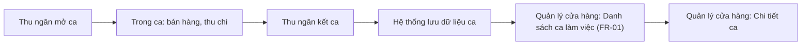

# Quản lý ca, kết ca

> Phạm vi tài liệu này (bản viết thử): chỉ **FR-01 — Xem danh sách ca làm việc**, chức năng duy nhất đã có màn Figma. Các chức năng còn lại của nghiệp vụ (Mở ca, Xem trong ca, Kết ca, Chi tiết ca) sẽ được bổ sung ở các lượt Update sau, khi có wireframe/Figma tương ứng.

## Lịch sử thay đổi tài liệu

| Ngày thay đổi | Vị trí thay đổi | Người viết | Mô tả thay đổi |
| :---- | :---- | :---- | :---- |
| 22/09/2026 | Toàn bộ | BA | Tạo mới — phạm vi thử nghiệm: chỉ FR-01 Xem danh sách ca làm việc |

## Tài liệu liên quan

| Tên tài liệu | Nguồn/Link |
| :---- | :---- |
| Giải pháp sơ bộ (brief) | `docs/briefs/brief-test-skill-2026-09-22/brief.md` |
| Ý tưởng brainstorm | `docs/brainstorming/brainstorm-quan-ly-ca-ket-ca-2026-09-22/brainstorm-intent.md` |
| Nghiên cứu cạnh tranh (Sapo, KiotViet) | `docs/research/competitive-sapo-va-kiotviet-quan-ly-ca-ket-ca-2026-09-22/research.md` |
| UX Experience | `docs/ux-designs/ux-test-skill-2026-09-22/EXPERIENCE.md` |
| Figma (wireframe màu) | https://www.figma.com/design/h4T7Q4qOWSHLyHXdSH3o45/EP?node-id=1165-833 (log: `docs/ux-designs/ux-test-skill-2026-09-22/figma/figma-log.md`) |
| Phân tích ảnh hưởng | *Chưa có — đề nghị chạy `impact-analysis` trước khi triển khai* |

## 1. Tổng Quan

### 1.1 Mục đích

Chức năng Quản lý ca, kết ca được xây dựng nhằm số hóa toàn bộ vòng đời một ca làm việc (mở ca, theo dõi trong ca, kết ca) và cung cấp dữ liệu đối chiếu, giúp quản lý cửa hàng có thể tra cứu và giải trình chênh lệch tiền mặt mọi lúc, thay cho quy trình ghi giấy/Excel hiện tại.

### 1.2 Đối tượng sử dụng

| Role | Mô tả |
| :---- | :---- |
| Thu ngân | Mở ca, xem tiền mặt trong ca, kết ca *(ngoài phạm vi FR chi tiết trong bản này)* |
| Quản lý cửa hàng | Xem danh sách ca làm việc, tra cứu/đối chiếu dữ liệu ca để giải trình với chủ cửa hàng — **đối tượng của FR-01** |
| Chủ cửa hàng | Xem doanh thu tổng quan *(ngoài phạm vi FR chi tiết trong bản này)* |

### 1.3 Phạm vi áp dụng

Áp dụng cho loại hình kinh doanh:
* Bán lẻ

Áp dụng cho nền tảng: EasyPOS bản Desktop.

### 1.4 Tổng quan luồng nghiệp vụ (Business process)

*Lưu ý: đẩy lên Confluence cần chèn ảnh xuất từ sơ đồ này (Confluence không tự render mermaid).*

## 2. Yêu cầu người dùng

| US-ID | Vai trò | Mong muốn | Mục đích |
| :---- | :---- | :---- | :---- |
| US-01 | Quản lý cửa hàng | Xem danh sách các ca làm việc, lọc theo khoảng thời gian/trạng thái/nhân viên | Có thể nhanh chóng tra cứu và đối chiếu dữ liệu ca khi cần giải trình với chủ cửa hàng |

## 3. Danh sách các chức năng

| FR-ID | Actor | Màn hình | Tên chức năng | Mô tả chức năng | Độ ưu tiên |
| :---- | :---- | :---- | :---- | :---- | :---- |
| FR-01 | Quản lý cửa hàng | Danh sách ca làm việc | Xem danh sách ca làm việc | Hiển thị danh sách các ca đã/đang diễn ra, lọc theo khoảng thời gian, trạng thái, nhân viên | P1 |

| Priority | Ý nghĩa |
| :---- | :---- |
| P1 | Bắt buộc, ảnh hưởng trực tiếp đến nghiệp vụ chính |
| P2 | Quan trọng nhưng có thể triển khai sau P1 |
| P3 | Có thể thực hiện ở phase sau |

## 4. Chi tiết các chức năng

### 4.1. FR-01 – Xem danh sách ca làm việc

#### 4.1.1. Màn hình chức năng

Figma: https://www.figma.com/design/h4T7Q4qOWSHLyHXdSH3o45/EP?node-id=1165-833 (frame `QLC-01 · Danh sách ca làm việc · Mặc định`)

| STT | Thành phần | Tên trường | Loại control | Giá trị mặc định | Bắt buộc | Mô tả |
| :---- | :---- | :---- | :---- | :---- | :---- | :---- |
| 1 | Bộ lọc | Khoảng thời gian | Date range picker | 01/09/2026 – 22/09/2026 `[ASSUMPTION: khoảng mặc định là gì — 30 ngày gần nhất, tháng hiện tại, hay ngày hôm nay? theo Figma đang để mặc định minh họa]` | Không | Format `DD/MM/YYYY – DD/MM/YYYY`; chọn qua lịch popup |
| 2 | Bộ lọc | Trạng thái | Dropdown (single-select) | Trống (= tất cả trạng thái) | Không | Giá trị: `Đang mở`, `Đã đóng`. Nguồn dữ liệu: danh sách cố định (enum trạng thái ca) |
| 3 | Bộ lọc | Nhân viên | Dropdown (single-select) | Trống (= tất cả nhân viên) | Không | Nguồn dữ liệu: danh sách thu ngân đang hoạt động của cửa hàng hiện tại |
| 4 | Bộ lọc | Nút "Lọc" | Button | — | — | Bấm để áp dụng các điều kiện lọc đã chọn `[ASSUMPTION: lọc chỉ áp dụng khi bấm nút, không lọc tự động (live) khi đổi giá trị dropdown — xem câu hỏi mở]` |
| 5 | Bảng | Nhân viên | Text (cột bảng) | — | — | Tên thu ngân đã mở ca |
| 6 | Bảng | Giờ mở ca | Text (cột bảng) | — | — | Format `HH:mm` |
| 7 | Bảng | Giờ đóng ca | Text (cột bảng) | — | — | Format `HH:mm`; để trống nếu ca đang mở (Trạng thái = Đang mở) `[ASSUMPTION]` |
| 8 | Bảng | Tiền đầu ca | Số (cột bảng) | — | — | Đơn vị VNĐ, định dạng `1.234.567đ`, căn phải |
| 9 | Bảng | Tiền kết ca | Số (cột bảng) | — | — | Đơn vị VNĐ, định dạng `1.234.567đ`, căn phải; để trống nếu ca đang mở `[ASSUMPTION]` |
| 10 | Bảng | Chênh lệch | Số (cột bảng) | — | — | Đơn vị VNĐ; = Tiền đầu ca + Tiền phát sinh trong ca − Tiền kết ca (BR-quanlyca-002); tô đỏ đậm nếu khác 0đ; để trống nếu ca đang mở |
| 11 | Bảng | Trạng thái | Tag | — | — | Giá trị: `Đang mở` (tag xanh dương), `Đã đóng` (tag xanh lá) — màu tag `Đang mở` chưa được duyệt chính thức, xem câu hỏi mở |

#### 4.1.2. Luồng xử lý

| Hạng mục | Mô tả |
| :---- | :---- |
| Mục đích UC | Cho phép quản lý cửa hàng tra cứu và đối chiếu dữ liệu các ca làm việc đã/đang diễn ra |
| Điều kiện kích hoạt | Người dùng có vai trò Quản lý cửa hàng đã đăng nhập EasyPOS và truy cập màn "Danh sách ca làm việc" |

**Main flow – Luồng chính**

| Bước | Hành động người dùng | Phản hồi hệ thống |
| :---- | :---- | :---- |
| 1 | Truy cập màn "Danh sách ca làm việc" | FE: Hiển thị danh sách ca theo khoảng thời gian mặc định `[ASSUMPTION: chưa chốt khoảng mặc định — xem câu hỏi mở]`, sắp xếp theo Giờ mở ca gần nhất trước `[ASSUMPTION]` |
| 2 | Chọn điều kiện lọc (Khoảng thời gian / Trạng thái / Nhân viên) | FE: Cập nhật giá trị đã chọn trên control tương ứng |
| 3 | Bấm nút "Lọc" | BE: Truy vấn dữ liệu ca theo điều kiện đã chọn (BR-quanlyca-001); FE: Hiển thị lại danh sách ca khớp điều kiện |
| 4 | Bấm vào một dòng ca trong bảng | FE: Chuyển sang màn "Chi tiết ca" tương ứng *(ngoài phạm vi chi tiết của FR-01 — sẽ mô tả ở FR riêng khi có wireframe/Figma)* |

**Alternative flow – Luồng rẽ nhánh**

| Bước | Điều kiện | Phản hồi hệ thống |
| :---- | :---- | :---- |
| 3a | Bấm "Lọc" khi không chọn Trạng thái và/hoặc Nhân viên | BE: Không áp dụng điều kiện lọc cho trường bỏ trống (chỉ lọc theo Khoảng thời gian); FE: Hiển thị toàn bộ ca trong khoảng thời gian đã chọn không phân biệt trạng thái/nhân viên |

**Exception flow – Luồng lỗi**

| Bước | Điều kiện | Thông báo hiển thị | Phản hồi hệ thống |
| :---- | :---- | :---- | :---- |
| 3b | Không có ca nào khớp điều kiện lọc | "Chưa có dữ liệu" | FE: Hiển thị trạng thái trống thay cho bảng dữ liệu, ẩn Pager (nếu có) |

#### 4.1.3. Quy tắc nghiệp vụ

| BR-ID | Quy tắc nghiệp vụ |
| :---- | :---- |
| BR-quanlyca-001 | Danh sách ca chỉ hiển thị các ca thuộc phạm vi lọc đã chọn (khoảng thời gian, trạng thái, nhân viên); một điều kiện không được chọn thì không áp dụng lọc theo điều kiện đó |
| BR-quanlyca-002 | Chênh lệch = (Tiền đầu ca + Tiền phát sinh trong ca) − Tiền mặt thực tế nhập lúc kết ca. Khi Chênh lệch khác 0đ, hiển thị bằng màu đỏ đậm để cảnh báo trực quan; khi bằng 0đ, hiển thị màu mặc định |
| BR-quanlyca-003 | Trạng thái ca trong danh sách chỉ gồm 2 giá trị: `Đang mở` (đã mở ca, chưa kết ca) và `Đã đóng` (đã kết ca); không có ca nào ở trạng thái "Chưa mở ca" xuất hiện trong danh sách này |

## 5. Luồng ảnh hưởng

*Chưa có Phân tích ảnh hưởng cho nghiệp vụ này — đề nghị chạy `impact-analysis` trước khi đưa vào triển khai thực tế, đặc biệt vì FR-01 tương tác với dữ liệu bán hàng và phiếu thu/chi hiện có (theo brief mục 3 "Phạm vi ảnh hưởng").*
